  
  
  
  

## Selected projects

<table>
  <tr>
    <td width="50%">
      
    </td>
    <td width="50%">
      
    </td>
  </tr>
</table>

## GitHub activity

  
  

  <a href="https://github.com/enneiymyabdeljalil-ctrl">GitHub</a>
  &nbsp;·&nbsp;
  <a href="https://www.linkedin.com/in/abde-ljalil-enneiymy-38795840a">LinkedIn</a>
  &nbsp;·&nbsp;
  <a href="mailto:enneiymeabdeljalil@gmail.com">Email</a>

  Custom SVG cards · GitHub Actions · Motion respects reduced-motion preferences

