## Explore

  
  
  

## GitHub activity

## Featured repositories

## Contribution graph

---

*Always learning. Always building. One step at a time.*

<!--
STATIC=1 python scripts/render_readme_cards.py renders still SVGs for screenshots.
Daily contribution refresh requires repository secret GH_PAT with read:user permission.
The workflow has contents:write permission to commit generated cards.
-->
